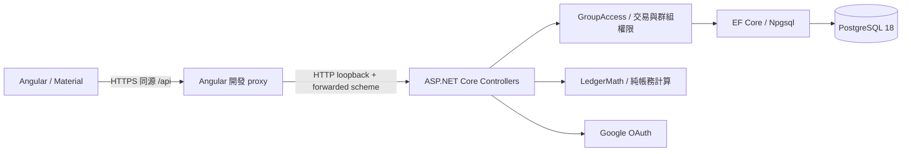
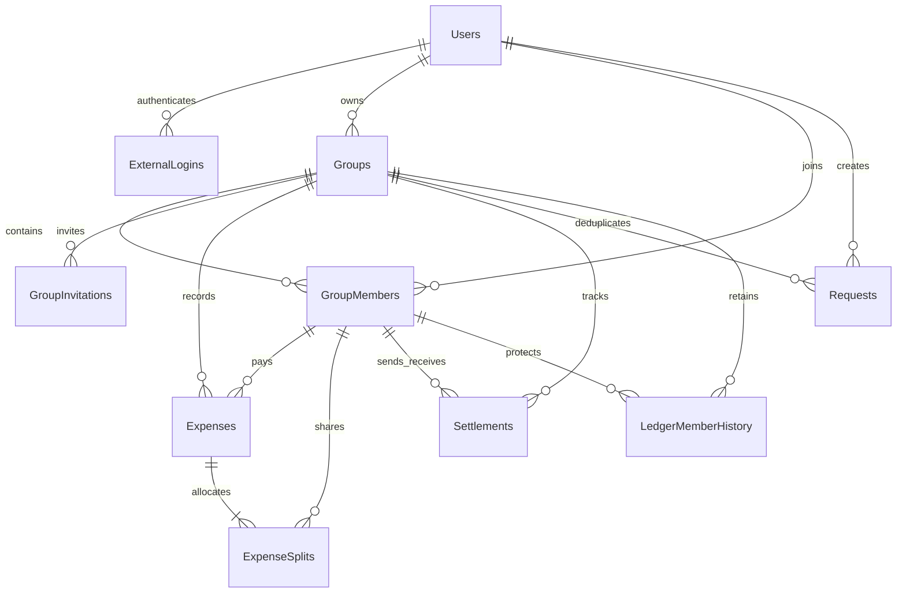

# 架構與資料設計

正式本機發佈產物由 ASP.NET Core wwwroot 提供 Angular SPA，直接在受信任 HTTPS endpoint 服務；沒有 CORS 跨來源依賴。開發 proxy 只信任 loopback，正式反向代理需另行設定已知來源。

## 專案分層

- Controllers：DTO、授權規則、API orchestration。
- GroupAccess：群組資格、Owner、交易鎖、一致快照、歷史成員保護。
- LedgerMath：不依賴資料庫的整數分攤、餘額、結算演算法。
- AppDb：PostgreSQL mapping、FK、check constraints、唯一索引及 EF Migration。Guid 使用 uuid；UTC DateTime 使用 timestamp with time zone；DateOnly 使用 date；金額使用 bigint。
- Angular Api service：HttpClient、同源 XSRF、登入 Signals、401 導回登入。
- Angular lazy routes：登入、群組、邀請、支出表單／詳情與群組 tabs。

所有實體 ID 都是 Guid。所有 FK DeleteBehavior.Restrict，不以 cascade 刪帳務。ExpenseSplits 更新時在同一個已鎖定群組交易內先移除舊 split，再加入新 split，以符合唯一約束；中途錯誤會全部 rollback。

群組鎖採 PostgreSQL transaction advisory lock。`DatabaseLocks` 把包含用途與資源 ID 的字串以 SHA-256 衍生成固定 64-bit key，透過參數化 `pg_advisory_xact_lock` 取得互斥；不同程序使用相同算法。所有群組寫入、成員變更與總帳快照都在相同鎖定協定下執行。碰撞僅會讓不相關操作額外排隊，不會破壞互斥。

第一次 Google 登入時身份資料列尚不存在，僅用 SELECT FOR UPDATE 不足。`ExternalUserService` 先取得 provider/subject 對應的 transaction advisory lock，再查詢／建立身份。以 READ COMMITTED 讓等待者在下一個 SELECT 看见前一筆 commit，避免 PostgreSQL Serializable 舊快照帶來的重試需求。示範 seed 也使用固定群組鎖保護不存在的群組。唯一索引仍為最後一道約束。

Compose 建立主資料庫與獨立測試資料庫；API 為 DML 帳號，Migration 為主庫 owner，測試帳號只擁有測試庫。PostgreSQL 18 volume 掛載 `/var/lib/postgresql`，只映射主機 loopback 5432。

## 安全與操作限制

- API 使用 HttpOnly session cookie；不把 provider token 放前端。
- 所有 MVC 寫入由 CsrfFilter 驗證。API auth failure 回 401/403，不回 Google HTML。
- ProblemDetails 不洩漏 exception stack／connection string。錯誤日誌只記 exception type 與 traceId。
- 禁用 ASP.NET request-level Info logs，避免 URL 中 invitation token 被記錄。正式前置 proxy 也必須遮蔽邀請與 callback query。
- 邀請依來源 IP 每分鐘最多 30 次。若未配置可信任代理的 client IP forwarding，反向代理下會共用配額；正式部署須按實際拓撲調整。
- TestLoginStartupFilter 與 TestHost 只在 tests 專案，正式 API 組件不包含假登入實作。
- /api/health 只檢查應用存活，/api/health/ready 才檢查 SQL 連線。
- 現階段清單／快照以小型朋友群組為容量假設，群組數與還款歷史沒有分頁，後續大量資料時應加入分頁／彙總查詢。

## API

開發時讀 `/openapi/v1.json`；核心路由符合原始規格。另外新增：
- GET `/api/auth/config`：Google 是否設定，不回傳憑證。
- GET `/api/groups/{id}/invitations`：Owner 查詢邀請 ID、期限、撤銷狀態，不回 token。
- DELETE 支出使用 query `?version=<Guid>`。
- balances 包含 `totalMinor`、`members`、`suggestions`，前端不另外呼叫 suggestions 導致不同快照。
